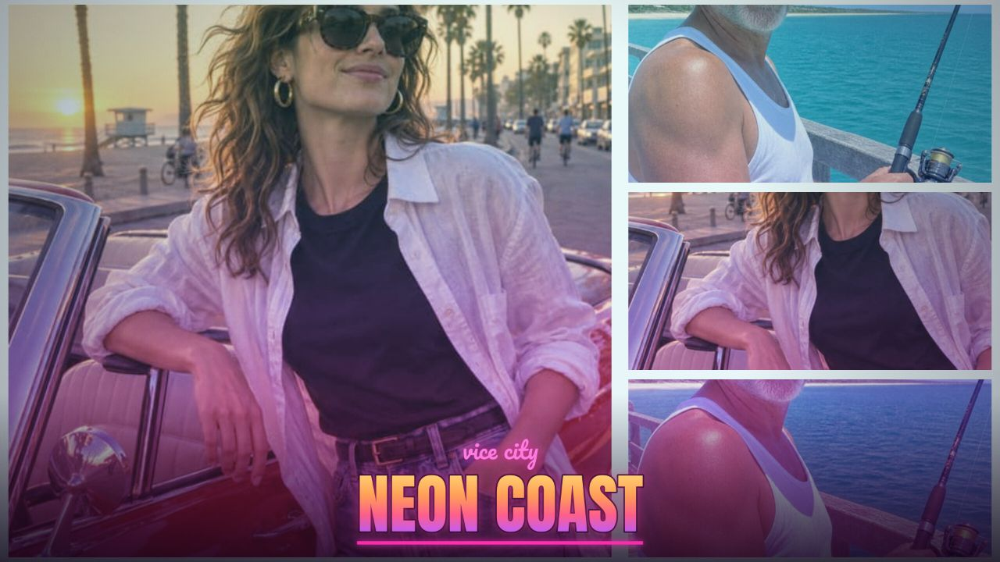

# Neon Coast Cover Studio

[](https://make.fun/bounty/gta6-cover-art-01?utm_source=github&utm_medium=readme&utm_campaign=gta6-cover-art-01)
[](https://make.fun/bounty/gta6-cover-art-01/leaderboard?utm_source=github&utm_medium=readme&utm_campaign=gta6-cover-art-01)
[](https://make.fun/bounty/gta6-cover-art-01?utm_source=github&utm_medium=readme&utm_campaign=gta6-cover-art-01)

Turn any photo and a caption into GTA-style cover art — the multi-panel poster look with bold lettering and a Vice City sunset or neon grade — exported as a PNG to share. Built for [make.fun](https://make.fun/bounty/gta6-cover-art-01).

**Offline by design:** the app is plain static files under `app/`. Open `app/index.html` in a desktop browser and it works with no network request. Photos are read on your own machine and never uploaded.



## How it works

1. **Photos** — upload up to 4 of your own photos, or use the two built-in samples (Boulevard, Pier). Click a photo to put it in the selected panel.
2. **Layout** — four poster layouts: Grid 2×2, Hero + 3, Full bleed, Grid 3×3.
3. **Grade** — five Vice City grades: Sunset, Neon night, Vice City, Golden hour, Noir.
4. **Size** — three post sizes: Square 1080×1080, Portrait 1080×1350, Wide 1920×1080.
5. **Caption** — a title in bold gradient lettering (Anton) and a neon script subtitle (Pacifico), both editable, with a title-size control.
6. **Per-panel crop** — click a panel on the cover to select it, drag it to move the photo, use the zoom slider to frame it.
7. **Export** — one click exports the current size as a PNG, or all three sizes at once.

## Try it

```sh
node serve.ts
# open http://localhost:8080
```

No build step, no install. Any static file server works.

## Files

- `app/index.html` — the editor page
- `app/style.css` — editor styling (dark UI, neon accents)
- `app/src/cover.js` — the cover engine: panel layouts, grades, gradient title lettering, grain and vignette
- `app/src/main.js` — wires the editor: photos, layout, grade, size, caption, per-panel crop, export
- `app/src/shots.js` — fixed `?shot=` scenes for screenshots
- `app/fonts/` — Anton and Pacifico, SIL Open Font License (OFL.txt)
- `app/samples/` — two sample photos, made with an image model for make.fun, free to use
- `screenshots/` — the cover art and the editor, as the app draws them
- `main.ts` — hands the app in: copies `app/` and `screenshots/` to `/output` and writes `dossier.json`
- `vendor/makefun-app.ts` — the kit's dossier library, unchanged

## Originality

Everything here is our own: the layout, the grades, the lettering (Anton and Pacifico under the SIL Open Font License) and the sample photos (made with an image model). No Rockstar Games logo, wordmark, official artwork, character or font is used anywhere.

## License

MIT — see [LICENSE](LICENSE).
